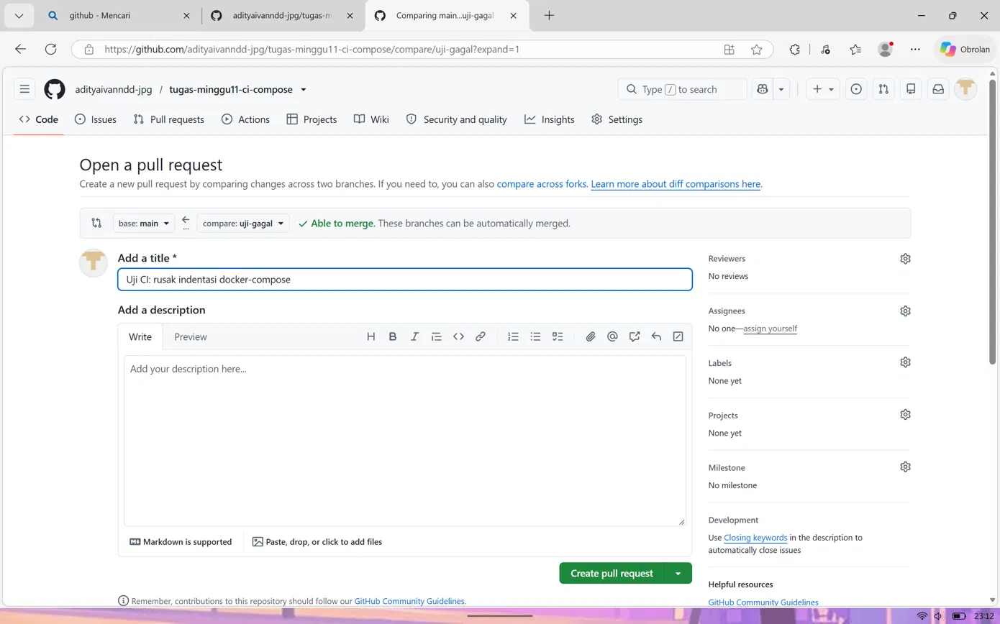
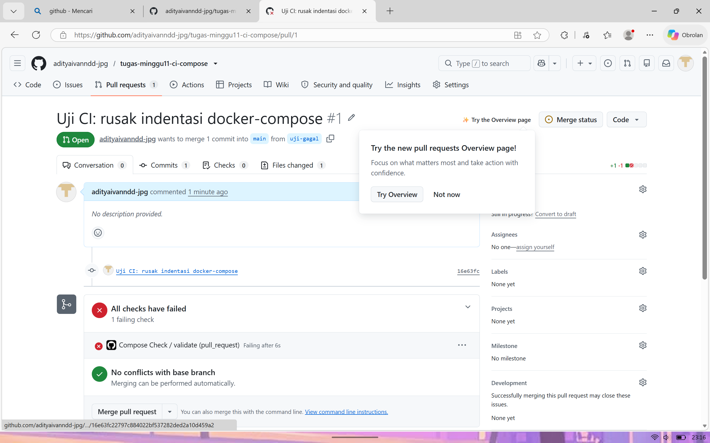
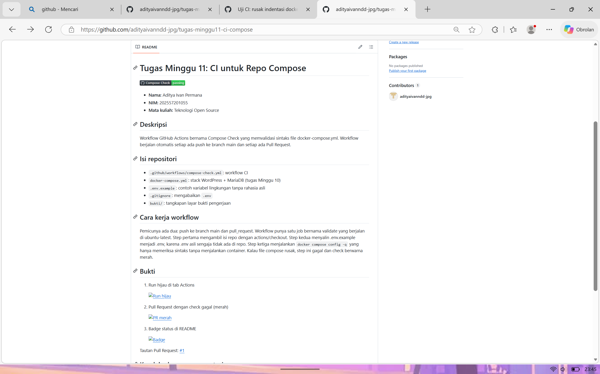

# Tugas Minggu 11: CI untuk Repo Compose

- **Nama:** Aditya Ivan Permana
- **NIM:** 202557201055
- **Mata kuliah:** Teknologi Open Source

## Deskripsi

Workflow GitHub Actions bernama Compose Check yang memvalidasi sintaks file docker-compose.yml. Workflow berjalan otomatis setiap ada push ke branch main dan setiap ada Pull Request.

## Isi repositori

- `.github/workflows/compose-check.yml`: workflow CI
- `docker-compose.yml`: stack WordPress + MariaDB (tugas Minggu 10)
- `.env.example`: contoh variabel lingkungan tanpa rahasia asli
- `.gitignore`: mengabaikan `.env`
- `bukti/`: tangkapan layar bukti pengerjaan

## Cara kerja workflow

Pemicunya ada dua: push ke branch main dan pull_request. Workflow punya satu job bernama validate yang berjalan di ubuntu-latest. Step pertama mengambil isi repo dengan actions/checkout. Step kedua menyalin .env.example menjadi .env, karena .env asli sengaja tidak ada di repo. Step ketiga menjalankan `docker compose config -q` yang hanya memeriksa sintaks tanpa menjalankan container. Kalau file compose rusak, step ini gagal dan check berwarna merah.

## Bukti

1. Run hijau di tab Actions

   

2. Pull Request dengan check gagal (merah)

   

3. Badge status di README

   

Tautan Pull Request: https://github.com/adityaivanndd-jpg/tugas-minggu11-ci-compose/pull/1

## Kendala dan cara mengatasinya

Pada Pull Request pertama, check Compose Check / validate gagal dengan pesan `yaml: line 4, column 12: mapping values are not allowed in this context` dan `Process completed with exit code 1`. Pesan ini muncul karena saya sengaja menghapus satu spasi di depan baris `image: mariadb:11`, sehingga indentasi YAML rusak. Dari log terlihat step checkout dan step siapkan .env berhasil, hanya step Validasi file compose yang gagal, jadi masalahnya ada di file compose, bukan di workflow. Saya memperbaikinya dengan mengembalikan indentasi menjadi empat spasi, lalu commit dan push ke branch yang sama. Check berjalan ulang dan berubah hijau.

## Refleksi singkat

Dengan CI, kesalahan pada file Compose ketahuan otomatis sebelum perubahan digabung ke main. Dari Pull Request yang sengaja gagal, saya melihat langsung bahwa check merah menahan file yang rusak dan check hijau menandakan file sudah benar. Membaca log juga membantu saya menemukan baris dan kolom penyebab error tanpa menebak.
